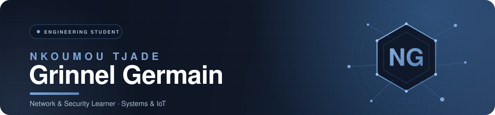

  

  

&ensp;

  

## 01 / ABOUT

I'm an engineering student interested in understanding how computer systems work, how they communicate, and how they can be built and secured.

My technical journey revolves around three complementary areas:

<table>
  <tr>
    <td width="33%" valign="top">
      <h3>01. Development</h3>
      Building digital solutions and exploring software engineering.  
      • Web &amp; mobile applications 
      • Backend systems &amp; APIs 
      • Database management 
      • AI-powered solutions
    </td>
    <td width="33%" valign="top">
      <h3>02. Networks &amp; Security</h3>
      Understanding infrastructures, communication and system protection.  
      • Network configuration 
      • Infrastructure labs 
      • Traffic analysis 
      • Security experiments 
      • Technical documentation
    </td>
    <td width="33%" valign="top">
      <h3>03. Systems &amp; IoT</h3>
      Exploring the interaction between software and physical systems.  
      • Embedded systems 
      • Microcontrollers 
      • Sensors &amp; electronics 
      • Hardware prototyping
    </td>
  </tr>
</table>

## 02 / WHAT YOU'LL FIND HERE

This GitHub profile is my technical workspace: a place to build, experiment, test and document what I learn.

<table align="center">
  <thead>
    <tr>
      <th align="left">Area</th>
      <th align="left">What's inside</th>
    </tr>
  </thead>
  <tbody>
    <tr><td>Software Engineering</td><td>Applications, backend services and APIs</td></tr>
    <tr><td>Databases</td><td>Database design, management and experiments</td></tr>
    <tr><td>Networking</td><td>Network topologies, configurations and infrastructure labs</td></tr>
    <tr><td>Cybersecurity</td><td>Security labs, practical exercises and technical reports</td></tr>
    <tr><td>Artificial Intelligence</td><td>AI experiments and intelligent applications</td></tr>
    <tr><td>Embedded Systems</td><td>Microcontroller-based projects and hardware experiments</td></tr>
  </tbody>
</table>

Not everything here is a finished product. Some repositories document ongoing experiments, practical exercises and concepts I'm working to understand better.

## 03 / TECHNOLOGY STACK

**DEVELOPMENT**  

  

**NETWORKS &amp; SECURITY**  

  

**SYSTEMS &amp; IoT**  

## 04 / TOP LANGUAGES

<table>
  <tr>
    <td width="50%" align="center">
      
    </td>
    <td width="50%" align="center">
      
    </td>
  </tr>
</table>

**ALWAYS LEARNING. ALWAYS BUILDING.** 
Understanding systems is the first step toward securing them.

  

<a href="https://nkoumougrinnel.netlify.app">PORTFOLIO</a>
&nbsp;·&nbsp;
<a href="https://github.com/nkoumougrinnel">GITHUB</a>

  

