  

  

&ensp;

&ensp;

  

## 01 / ABOUT

I'm an engineering student interested in understanding how computer systems work, how they communicate, and how they can be built and secured.

My technical journey revolves around three complementary areas:

  

## 02 / WHAT YOU'LL FIND HERE

This GitHub profile is my technical workspace: a place to build, experiment, test and document what I learn.

  

Not everything here is a finished product. Some repositories document ongoing experiments, practical exercises and concepts I'm working to understand better.

## 03 / TECHNOLOGY STACK

  
    
  
    
  

## 04 / TOP LANGUAGES

<table>
  <tr>
    <td width="50%" align="center">
      
    </td>
    <td width="50%" align="center">
      
    </td>
  </tr>
</table>

**ALWAYS LEARNING. ALWAYS BUILDING.** 
Understanding systems is the first step toward securing them.

 

